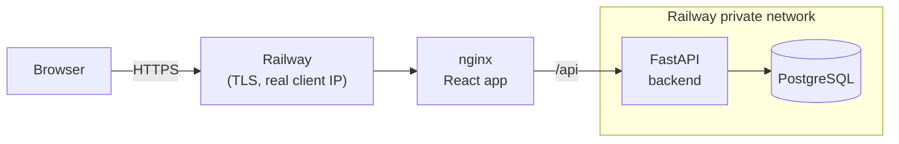

# Car Fleet Manager

[Slovenčina](README.md) | **English**

A web application for managing company cars and booking service appointments.

**Live:** https://fearless-rebirth-production-132141c8.up.railway.app

## Features

- **Sign-up and sign-in.** Anyone can create an account. An admin can only be created with a command on the server.
- **Service booking.** A monthly calendar; clicking a day shows hourly slots from 8:00 to 17:00.
  A slot can't be booked twice.
- **Bookings for the admin.** The admin sees who is coming and when, including the note, and can cancel bookings.
- **Fleet (admin only).** Cars with technical inspection (STK) validity, service history with costs, and an
  overview of cars whose inspection is expiring or overdue.
- **Price list** of services and an **e-shop** (coming soon).

## Architecture



Only the frontend is publicly reachable. nginx serves the React app to the browser and forwards
requests for `/api` to the backend. Neither the backend nor the database has a public address.

## Tech stack

| Part | What's used |
|---|---|
| Backend | Python, FastAPI, SQLAlchemy, Alembic (migrations), PostgreSQL |
| Frontend | React, TypeScript, Vite, React Router, plain CSS |
| Operations | Docker, nginx, Railway, GitHub Actions (tests and linting on every push) |

## Security

- Passwords are stored only as a hash (Argon2).
- The token (JWT) lives in an **httpOnly cookie** that JavaScript on the page can't read. The cookie is
  `Secure` and `SameSite=Strict`, and changes also require a CSRF header.
- **Signing out** revokes the token immediately, not only when it expires.
- Password guessing and mass sign-ups are **rate limited per IP address**. Attempts are stored in the
  database, so the limit survives restarts.
- Permissions are enforced by the backend (`401` when signed out, `403` when not allowed), not just by hidden buttons.
- nginx enforces HTTPS and sends security headers (HSTS, Content-Security-Policy).

## Structure

```
backend/    API: endpoints, database models, migrations, tests
frontend/   React app and nginx
```
