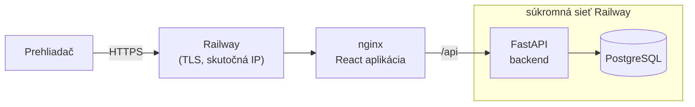

# Car Fleet Manager

**Slovenčina** | [English](README.en.md)

Webová aplikácia na správu firemných áut a rezerváciu termínov servisu.

**Naživo:** https://fearless-rebirth-production-132141c8.up.railway.app

## Čo aplikácia vie

- **Registrácia a prihlásenie.** Účet si vytvorí každý sám. Admin vzniká len príkazom na serveri.
- **Termín servisu.** Kalendár mesiaca, po kliknutí na deň hodinové termíny od 8:00 do 17:00.
  Jeden termín sa nedá rezervovať dvakrát.
- **Rezervácie pre admina.** Admin vidí, kto a kedy príde, aj s poznámkou, a môže rezervácie rušiť.
- **Vozový park (len admin).** Autá s platnosťou STK, servisná história s cenami, prehľad áut
  s končiacou alebo neplatnou STK.
- **Cenník** servisných úkonov a **e-shop** (pripravuje sa).

## Architektúra



Verejne dostupný je len frontend. nginx posiela prehliadaču React aplikáciu a požiadavky
na `/api` posiela ďalej na backend. Backend ani databáza nemajú verejnú adresu.

## Technológie

| Časť | Čo je použité |
|---|---|
| Backend | Python, FastAPI, SQLAlchemy, Alembic (migrácie), PostgreSQL |
| Frontend | React, TypeScript, Vite, React Router, obyčajné CSS |
| Prevádzka | Docker, nginx, Railway, GitHub Actions (testy a kontrola kódu pri každom pushi) |

## Bezpečnosť

- Heslá sú uložené len ako hash (Argon2).
- Token (JWT) je v **httpOnly cookie**, ktorú JavaScript na stránke neprečíta. Cookie je `Secure`
  a `SameSite=Strict`, zmeny navyše vyžadujú hlavičku proti CSRF.
- **Odhlásenie** token zruší okamžite, nie až keď vyprší.
- Hádanie hesiel a hromadná registrácia majú **limit na IP adresu**. Pokusy sú v databáze,
  takže limit platí aj po reštarte.
- Oprávnenia kontroluje backend (`401` neprihlásený, `403` bez oprávnenia), nie len skryté tlačidlá.
- nginx vynúti HTTPS a posiela bezpečnostné hlavičky (HSTS, Content-Security-Policy).

## Štruktúra

```
backend/    API: endpointy, databázové modely, migrácie, testy
frontend/   React aplikácia a nginx
```
