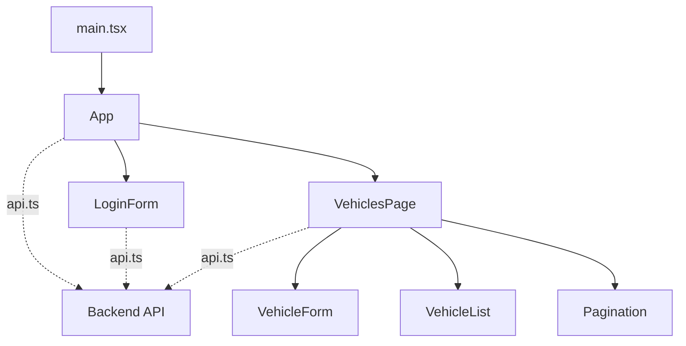

# Frontend

React + TypeScript aplikácia postavená na Vite. Ako ju spustiť, je v [hlavnom README](../README.md#spustenie).

V Dockeri ju spúšťa `Dockerfile` v tomto priečinku: vo vývoji fáza `dev` (Vite dev server),
v produkcii posledná fáza, kde hotový build posiela nginx podľa `nginx.conf`.

## Súbory v `src/`

```
main.tsx                  vstupný bod: vykreslí App do <div id="root"> v index.html
App.tsx                   token a prihlásený používateľ, hlavička, stránky (React Router)
api.ts                    všetka komunikácia s backendom (fetch, token v hlavičke, texty chýb)
types.ts                  TypeScript typy zodpovedajúce schémam backendu (Vehicle, User, ...)
index.css                 všetky štýly
components/
  LoginForm.tsx           prihlasovací formulár
  VehiclesPage.tsx        stránka s autami: načítanie, stránkovanie, pridanie, úprava, mazanie
  VehicleList.tsx         tabuľka áut (len zobrazuje, dáta dostane cez props)
  VehicleForm.tsx         formulár na pridanie aj úpravu auta
  Pagination.tsx          tlačidlá Predchádzajúca / Ďalšia
```

## Komponenty



Dáta tečú zhora nadol cez props, udalosti idú hore cez funkcie v props (`onLogin`, `onSave`, `onDelete`, ...).
Token a prihláseného používateľa drží `App`, autá a stránkovanie `VehiclesPage`.

## Stránky

| Adresa | Čo zobrazí |
|---|---|
| `/login` | prihlásenie (prihláseného presmeruje na `/vehicles`) |
| `/vehicles` | zoznam áut (neprihláseného presmeruje na `/login`) |
| hocičo iné | presmeruje na `/vehicles` |

Tlačidlá na pridanie, úpravu a mazanie vidí len admin. Je to len pohodlie pre používateľa,
skutočnú kontrolu oprávnení robí backend (vodičovi vráti `403`).
