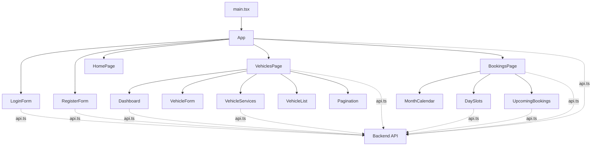

# Frontend

React + TypeScript aplikácia postavená na Vite. Ako ju spustiť, je v [hlavnom README](../README.md#spustenie).

V Dockeri ju spúšťa `Dockerfile` v tomto priečinku: vo vývoji fáza `dev` (Vite dev server),
v produkcii posledná fáza, kde hotový build posiela nginx podľa `nginx.conf`.

## Súbory v `src/`

```
main.tsx                  vstupný bod: vykreslí App do <div id="root"> v index.html
App.tsx                   token a prihlásený používateľ, hlavička, stránky (React Router)
api.ts                    všetka komunikácia s backendom (fetch, token v hlavičke, texty chýb)
types.ts                  TypeScript typy zodpovedajúce schémam backendu (Vehicle, User, ...)
dates.ts                  pomocné funkcie na dátumy (dnešok, formátovanie, dni do termínu, mriežka mesiaca)
slots.ts                  pravidlá rezervácií: otváracie hodiny, čo je minulosť, farba termínu
index.css                 všetky štýly
assets/car-outline.svg    sivý obrys auta na pozadí dashboardu a karty v menu
assets/calendar-outline.svg  sivý obrys kalendára na karte v menu
components/
  LoginForm.tsx           prihlasovací formulár
  RegisterForm.tsx        registrácia nového účtu, po nej rovno prihlási
  HomePage.tsx            úvodná stránka: privítanie a menu (Vozový park, Termín servisu)
  BookingsPage.tsx        stránka s rezerváciami: načítanie, zobrazený mesiac a otvorený deň
  MonthCalendar.tsx       veľký kalendár mesiaca (len zobrazuje, dáta dostane cez props)
  DaySlots.tsx            hodinové termíny jedného dňa: rezervácia a zrušenie
  UpcomingBookings.tsx    zoznam najbližších rezervácií pod kalendárom
  VehiclesPage.tsx        stránka s autami: načítanie, stránkovanie, pridanie, úprava, mazanie
  Dashboard.tsx           prehľad hore: počet áut, končiaca STK, autá po STK
  VehicleList.tsx         tabuľka áut (len zobrazuje, dáta dostane cez props)
  VehicleForm.tsx         formulár na pridanie aj úpravu auta
  VehicleServices.tsx     servisné záznamy jedného auta: zoznam, súčet a formulár na pridanie
  Pagination.tsx          tlačidlá Predchádzajúca / Ďalšia
```

## Komponenty



Dáta tečú zhora nadol cez props, udalosti idú hore cez funkcie v props (`onLogin`, `onSave`, `onDelete`, ...).
Token a prihláseného používateľa drží `App`, autá a stránkovanie `VehiclesPage`,
zobrazený mesiac, otvorený deň a rezervácie `BookingsPage`.

## Stránky

| Adresa | Čo zobrazí |
|---|---|
| `/login` | prihlásenie |
| `/register` | registrácia nového účtu |
| `/` | úvodná stránka s menu |
| `/vehicles` | zoznam áut, len pre admina (ostatných presmeruje na `/`) |
| `/bookings` | kalendár s termínmi servisu |
| hocičo iné | prihláseného presmeruje na `/`, neprihláseného na `/login` |

Prihlásený sa na `/login` a `/register` nedostane (presmeruje ho na `/`), neprihlásený vidí len tieto dve stránky.

Vozový park (karta v menu, odkaz v hlavičke aj stránka `/vehicles`) vidí len admin. Je to len
pohodlie pre používateľa, skutočnú kontrolu oprávnení robí backend (vodičovi vráti `403`).

Pastelové farby termínov sú v `index.css` zapísané cez `oklch()`: každá hodina má vlastný odtieň
(posiela ho `slots.ts` v premennej `--hue`), svetlosť a sýtosť majú všetky rovnakú.
